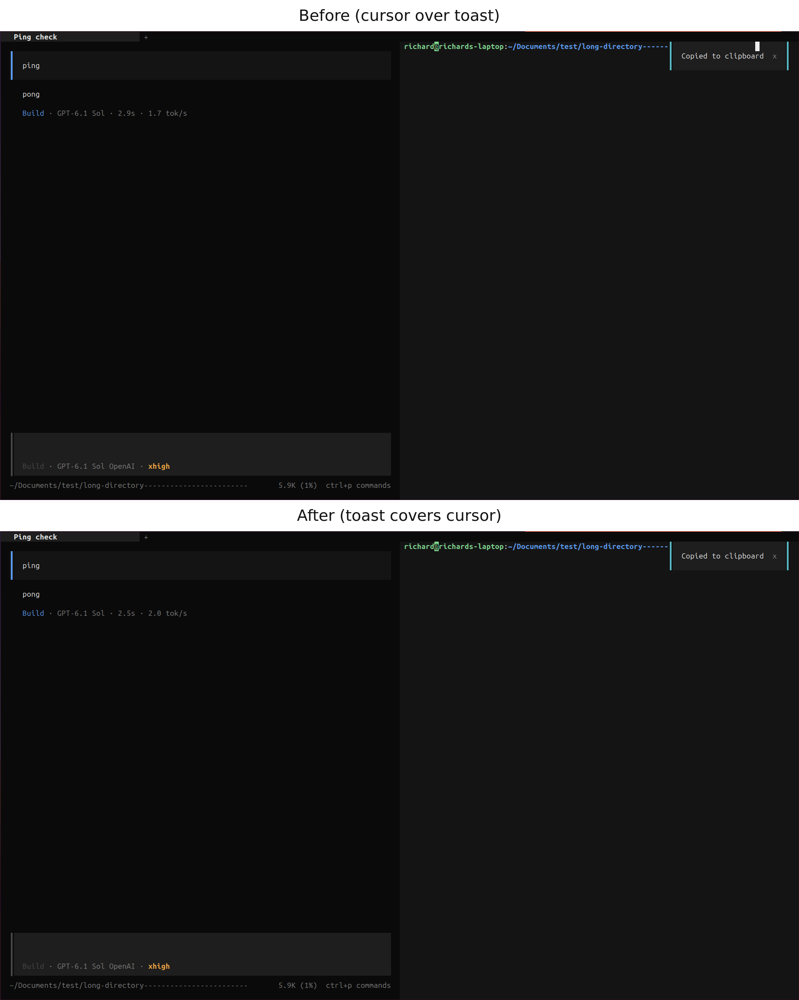

# Terminal cursor behind toast notifications

- Issue: https://github.com/anomalyco/opencode/issues/60215
- Fix: https://github.com/richardharnisch/opencode/commit/143d4483fd
- PR branch: `richardharnisch:toast-cursor`, merged with upstream `dev` at `589c62db60a4ae25e845e440eef64dd007101dc9`.

This branch contains review evidence only. The proposed source change is limited to `packages/tui/src/ui/toast.tsx` and its existing test file.

## Before and after

The reporter manually tested the fix and supplied two local screenshots taken on 2026-10-29: 15:04:56 (before) and 15:07:05 (after). These are the primary images used in the prepared PR description.

The white terminal cursor is visible over the notification before the fix and hidden afterward. The first two images below are unchanged crops of the notification area. The full comparison preserves both complete screenshots at their original resolution, without redaction or changes to their pixels. Only the Before/After labels were added outside the screenshots. The original files remain unchanged.

### Before


### After


### Full comparison



## Additional verification captures

The earlier captures used the real OpenCode TUI, including `/terminal` and mouse-driven copy-on-selection, through Terminal Control 1.2.1. The baseline is the installed OpenCode 2.2.1 release. The fixed client is the source branch above. Both use OpenTUI 0.7.0. In these captures, the terminal cursor is at the same cell before and after the fix.

Additional screenshots: [before detail](before-detail.png), [after detail](after-detail.png), [full before](before.png), [full after](after.png), [after expiry, with the cursor restored](restored.png), and [88-column layout](after-narrow.png).

These additional captures used a dedicated synthetic database, isolated HOME/XDG directories, no external plugins, and no model requests. No live session data or credentials were used in that verification.

## Reproduce

1. Open a session and run `/terminal`.
2. In the side terminal, run:
   ```sh
   printf '\033[2J\033[Hselect this text\033[2;999H\033[6D'; sleep 30
   ```
3. Select `select this text` with the mouse.
4. Check the upper-right notification. Press Ctrl+C to finish the shell command.

The fix hides only a cursor whose cell is within the toast's current bounds. It does not blur the terminal, change the embedded application's cursor state, or change cursor shape/color/blinking. The focused renderable supplies its cursor state again on the next frame, so moving outside the toast or dismissing it restores the appropriate visibility.

## Verification

Linux x86_64, Bun 1.4.4, dependencies from the frozen lockfile. Final checks ran after merging upstream `dev` into source commit `143d4483fd`.

| Check | Result |
| --- | --- |
| `bun run check` from the repository root | Pass, with repository warnings; zero lint/type errors |
| `bun run typecheck:tsc` from `packages/tui` | Pass |
| `bun test --timeout 30000 test/cli/tui/toast.test.tsx --rerun-each 10` | 40 pass, 0 fail |
| Regression negative control, without the fix | 2 fail, 2 pass |
| Prettier on both changed files and `git diff --check` | Pass |
| Full TUI suite, fixed branch | 1565 pass, 2 skip, 1 fail |
| Earlier full TUI suite, unchanged original base (`726cf09639`) | 1563 pass, 2 skip, 1 fail |

Both full-suite runs fail the same existing assertion in `test/component/go-upsell-art.test.tsx`: the art is `▀▀▀▀ ▀▀▀▀`, while the test expects `█▀▀▀ █▀▀█`. A focused run on current upstream `dev` (`589c62db60`), without the fix, also reproduces that assertion and both toast regression failures. The fix does not change the art component. An earlier command-limited full-suite attempt timed out and reported a shell-output failure; all 18 shell-output checks passed in three repeat runs on each branch.

One parameterized regression runs at widths 44 and 100. It checks that an uncovered cursor stays visible, a covered cursor stays hidden across another frame, focus stays on the terminal, and dismissal restores the cursor. The test diff is 51 added lines, including imports and setup, and two replaced import lines; the fix is eight added lines.

Live TUI checks also covered notification expiry, resizing to 88 columns, and shell input after copying. The reporter separately confirmed the fix in their local terminal and supplied the primary screenshots above. macOS, Windows, and additional terminal emulators were not tested locally. Upstream PR CI has not run because the PR has not been opened.
